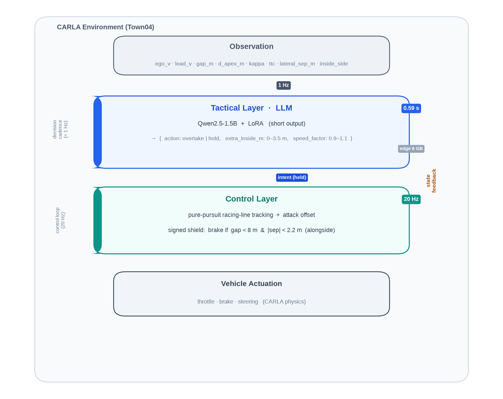

# Low-Latency Edge LLM Tactical Decision-Making for High-Speed Autonomous Overtaking

A 1.5B local large language model (Qwen2.5 + LoRA) that decides *overtake or hold*
in **0.59 s** — an order of magnitude faster than cloud-API LLMs — while a 20 Hz
rule-based controller keeps the maneuver safe. Evaluated in closed-loop CARLA.

> **Website**: [`docs/index.html`](docs/index.html) (GitHub Pages)
> **Paper**: [`paper/paper_ieee.tex`](paper/paper_ieee.tex) (IEEE conference format)

## Key Results

| Metric | Value |
|---|---|
| Decision latency (1.5B-short) | **0.59 s** |
| Decision accuracy | **86.1%** |
| Closed-loop pass rate (10 scenarios × 10 seeds) | **96%** (96/100) |
| Collision rate | **2%** |
| Median lateral clearance | ≥ 2.2 m |
| Zero-shot generalization | 10 scenarios from 2 corner geometries |

The 1.5B short-output model is the **Pareto-optimal point**: 3.4× faster than 3B
and 2.4× faster than 7B, while *more* accurate (bigger models must be quantized
to 4-bit to fit 8 GB).

## Overview

We argue that an LLM for driving should act only as a **low-frequency tactical
layer** (~1 Hz), issuing coarse intents (`overtake|hold`, attack offset, speed
factor), while a classical **control layer** (20 Hz) handles trajectory tracking
and safety. This two-timescale decomposition absorbs decision latency into the
decision *cadence*, so a sub-second decision is tolerable and a multi-second
(cloud) one is stale.

<div align="center">
  
</div>

## Repository Layout

```
├── paper/
│   ├── paper_ieee.tex        # IEEE conference paper (ITSC/IV)
│   ├── references.bib        # BibTeX references
│   └── figures/              # vector figures (PDF/SVG)
├── docs/
│   ├── index.html            # project website (GitHub Pages)
│   └── assets/               # videos, GIFs, figures
├── finetune/                 # LoRA training + serving + eval
├── results/                  # benchmark outputs + stats
└── README.md
```

## Method

- **Tactical layer**: Qwen2.5-1.5B-Instruct + LoRA (r=16, α=32), short-output
  variant (no `reason` field) at 0.59 s.
- **Control layer**: pure-pursuit racing-line tracking + a geometric *signed
  shield* (brakes when alongside with insufficient lateral clearance).
- **Data**: rule-expert demonstrations + **counterfactual labels** (roll out
  candidate actions against the CARLA simulator, label with the lowest cost).

## Honest Negative Results

1. **Multi-scenario behavior cloning regresses** — fine-tuning on data from a
   rule expert that only *holds* on hard scenarios teaches conservatism
   (catastrophic forgetting).
2. **CBF-QP underperforms a geometric shield** in a 2 m stress test.

## Citation

```bibtex
@misc{llm-overtaking-2026,
  title  = {Low-Latency Edge LLM Tactical Decision-Making for High-Speed Autonomous Overtaking},
  author = {Author Name},
  year   = {2026},
  note   = {Under review}
}
```

## License

MIT (fill in before release).
